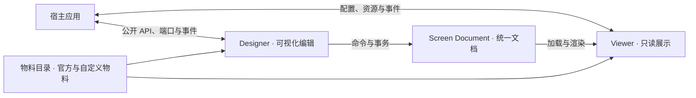

# Base Screen

[](./LICENSE)


> Lightweight, embeddable, cross-framework dashboard designer foundation for the web.

Base Screen 是一个轻量、可嵌入、跨框架的大屏设计器基座，为现有 Web 应用提供可视化编辑、只读渲染和
物料扩展能力。宿主可以只接入展示页，也可以嵌入完整的设计器工作台，同时保留自己的业务界面和技术栈。

项目以 **Screen Document** 作为统一文档，以 **Web Components** 作为浏览器集成边界，以 **物料目录**
描述可使用的可视组件。Designer 编辑和 Viewer 展示围绕同一份文档工作；项目、数据、资产、发布和长任务的
真实处理由宿主负责，Base Screen 提供当前实例内的编辑、渲染与有界宿主端口。

[快速体验](#快速体验) · [在你的应用中使用](#在你的应用中使用) · [示例总览](./examples/README.md)

## 适用场景

- 在已有业务系统中嵌入大屏编辑页，复用宿主的账号、权限、路由、项目存储和发布流程。
- 根据同一份大屏文档提供编辑预览和只读展示，并通过宿主端口接入业务数据与变量。
- 建立自己的可视化物料库，将原生 Web Components、React 或 Vue 组件接入统一的设计与渲染流程。

Base Screen 的交付重点是可组合的前端基座。示例中的项目目录、资源列表和模拟数据用于说明接入方式，
生产环境中的业务规则与服务仍由宿主实现。

## 核心能力

- **统一文档与编辑历史**：严格的文档解析、诊断、序列化和 JSON Schema；编辑通过命令与事务提交，
  支持撤销、重做和当前项目会话的脏状态管理。
- **画布设计与属性编辑**：单选与多选、移动、缩放、旋转、编组、图层排序、吸附和参考线，
  配合属性检查器、批量样式编辑、调色板及静态文本的画布内直接编辑。
- **独立 Viewer**：消费文档与物料目录进行展示，不包含设计器编辑逻辑；宿主可单独使用
  `base-screen-viewer` 构建预览页或发布页。
- **官方物料与分类浏览**：核心库提供文本、矩形、椭圆、图片、容器、图表和表格物料（ECharts 等重型
  图表能力由 `plugins/` 外围插件承载）；
  物料库支持搜索、收藏、最近使用、宿主多级分组、条目封面和窄面板分类浮层。
- **数据与视觉联动**：支持静态数据、宿主资源与变量；声明数据绑定能力的物料可使用数据集参数、字段映射
  和预览。条件样式与 Blueprint 运行时用于表达组件状态变化、事件联动与组件关联，实际数据处理由宿主完成。
- **Canvas / Blueprint 工作台**：画布与蓝图共用文档、事务和历史；蓝图以一等组件关系表达交互、数据、业务出口与语义关联；Base Screen 提供工作台外壳、
  语义面板和图投影，中央图形渲染、布局算法及画布手势由宿主接入。
- **物料与宿主扩展**：通过 Manifest 声明属性、样式、事件和编辑控件，支持 React/Vue 物料桥接、
  插件能力授权、主题 Token、公开命名 slot，以及宿主资源插入、拖放和替换。

## 快速体验

本仓库开发环境要求 Node.js `22`（精确 patch 以 CI 矩阵为准）、pnpm `11.18.0`。

```bash
pnpm install --frozen-lockfile
pnpm build
pnpm dev:browser-harness  # 浏览器验证矩阵（tooling/verification/browser-harness）
```

打开终端输出的本地地址即可查看浏览器组合示例；专项案例导航页是 `/cases.html`，`?designer` 为
验收用全屏设计器。示例自带演示文档与模拟宿主能力。

## 在你的应用中使用

底层 API 接入通常分为四步：注册元素与物料 → 组装物料目录 → 解析文档 → 配置并装载。下面的最小 Viewer 工程展示完整控制面；如需减少每个页面重复的装配代码，可使用后面的[组合层](#组合层快速接入)。

```html
<body>
  <base-screen-viewer></base-screen-viewer>
</body>
```

```ts
import { parseScreenDocument } from '@base-screen/contracts';
import {
  defineBaseScreenRectangleMaterial,
  defineBaseScreenTextMaterial,
} from '@base-screen/material';
import { createBaseScreenMaterialCatalog } from '@base-screen/plugin-core';
import { defineBaseScreenViewer } from '@base-screen/sdk/viewer';

// 1. 注册 <base-screen-viewer> 与官方物料
const viewerDefinition = defineBaseScreenViewer();
const text = defineBaseScreenTextMaterial();
const rectangle = defineBaseScreenRectangleMaterial();
if (!viewerDefinition.ok || !text.ok || !rectangle.ok) {
  throw new Error('Base Screen Custom Element registration failed.');
}

// 2. 组装当前实例可用的物料目录
const catalog = createBaseScreenMaterialCatalog([text.value, rectangle.value]);

// 3. 解析文档；入参为 Screen Document JSON，解析是 fail-closed 的，请处理返回的诊断
const parsed = parseScreenDocument(screenDocumentJson);
if (!parsed.ok) {
  throw new Error(parsed.diagnostics[0]?.message ?? '文档解析失败');
}

// 4. 配置成功后再装载文档
const viewer = document.querySelector('base-screen-viewer')!;
const configured = viewer.configure({ catalog, instanceId: 'my-viewer', mode: 'viewer' });
if (!configured.ok) {
  throw new Error(configured.diagnostics[0]?.message ?? 'Viewer 配置失败');
}
viewer.document = parsed.value;
```

### 组合层快速接入

`@base-screen/sdk` 提供可选的 `createBaseScreenRuntime()`：一次完成 Designer/Viewer 与官方物料注册、插件激活及授权检查、catalog 合并，以及元素挂载和销毁编排。它只组合现有公共 API，`defineBaseScreen*()`、`configure()`、端口、slot 和元素命令 API 均保持不变。

```ts
import { createBaseScreenRuntime } from '@base-screen/sdk';

const runtimeResult = await createBaseScreenRuntime({
  instanceId: 'my-app',
  // 可选：宿主插件、授权与自有物料；省略时仅注册官方物料。
  plugins: [],
  grantedCapabilities: {},
});
if (!runtimeResult.ok) {
  throw new Error(runtimeResult.diagnostics[0]?.message ?? 'Base Screen 初始化失败');
}
const runtime = runtimeResult.value;

const mounted = await runtime.mountDesigner(stage, {
  projectId: 'screen-1',
  projectAdapter,
  resourcePort,
  datasetPort,
  backButton: true,
});
if (!mounted.ok) {
  throw new Error(mounted.diagnostics[0]?.message ?? '设计器挂载失败');
}

const designer = mounted.value;
// 事件与宿主资源清理可登记到句柄，dispose 时逆序释放。
designer.on('base-screen-project-conflict', onProjectConflict);
designer.onDispose(() => assetLibrary.dispose());

// 高级能力仍走完整底层元素 API。
designer.element.refreshCatalog(nextCatalog);

// 页面卸载时只需释放句柄；应用退出时释放共享 runtime。
await designer.dispose();
await runtime.dispose();
```

`mountViewer()` 同样自动注入 catalog 与插件贡献，宿主只需提交已解析或迁移后的 `document`；`projectId` 与 `document` 两种 Designer 模式不能混用。Designer 挂载会按目录中存在的官方物料补齐文本、矩形、椭圆、图片工具与成组角色，宿主可用 `toolMaterialTypes`、`groupMaterialType` 覆盖；空的工具映射可关闭工具。一个 runtime 对应一个 Designer 编辑会话，重复挂载第二个 Designer 会返回诊断；并行编辑应使用独立 runtime，多个 Viewer 可共享。

`runtime.setCatalog(nextCatalog)` 默认热刷新仍使用运行时默认目录的 SDK 挂载，保留编辑文档、选区和历史；独立指定目录的挂载不受影响。任一刷新失败时保留运行时默认值，并回滚此前成功刷新的实例，回滚失败也会返回诊断。显式传入 `{ target: 'future-mounts' }` 则只改变后续挂载。宿主手动绑定的元素仍通过 `element.refreshCatalog()` 更新。端口和其他初始化配置需要在显式重挂载时生效。`runtime.dispose()` 会卸载全部挂载句柄并释放插件管理器，且可重复调用。

蓝图能力可以通过 `createBaseScreenRuntime({ blueprintCapabilities: [...] })` 一次显式声明并授权；省略时不开放任何能力。已有 manager 的宿主使用 `createBaseScreenBlueprintCapabilityPlugin({ id, capabilities })`（根入口或 `sdk/plugins`），把返回的 `plugin` 与 `grantedCapabilities` 放入 manager 配置；贡献、授权列表及空生命周期由组合层统一生成。能力词汇仍以 contracts 的 `SCREEN_BLUEPRINT_CAPABILITY_IDS` 为准。

如果宿主已经拥有自己的 `HostRuntime`（manager、catalog、在线物料与插件贡献），用 `adoptBaseScreenRuntime(host)` 把它适配成 `BaseScreenRuntime`，不要再调用 `createBaseScreenRuntime()`：

```ts
import { adoptBaseScreenRuntime } from '@base-screen/sdk';

const host = await loadHostRuntime();
const runtime = adoptBaseScreenRuntime(host);
```

适配器复用同一份 manager/catalog，只补挂载句柄、catalog 替换和销毁编排。它用于已有外部 runtime 的宿主；三端完整示例直接使用标准 `createBaseScreenRuntime()`，不再自建 manager 后再适配。`materials` 可直接接收 React/Vue 桥产出的 catalog 条目并保留表格数据适配器，宿主无需手写注册和构造器静态属性。`@base-screen/contracts`、`@base-screen/material`、`@base-screen/plugin-core`、`@base-screen/plugin-manager` 与 `@base-screen/plugin-sdk` 也可分别从 SDK 的对应子入口导入。

### 轻量 Viewer 组合层

只读页面可从 `@base-screen/sdk/viewer` 导入 `createBaseScreenViewerRuntime()`，复用挂载、目录热刷新与销毁编排：

```ts
import { parseScreenDocument } from '@base-screen/sdk/contracts';
import { defineBaseScreenTextMaterial } from '@base-screen/sdk/material';
import { createBaseScreenViewerRuntime } from '@base-screen/sdk/viewer';

const text = defineBaseScreenTextMaterial();
if (!text.ok) throw new Error(text.diagnostics[0]?.message);
const parsed = parseScreenDocument(screenDocumentJson);
if (!parsed.ok) throw new Error(parsed.diagnostics[0]?.message);

const result = await createBaseScreenViewerRuntime({
  instanceId: 'my-viewer',
  materials: [text.value],
});
if (!result.ok) throw new Error(result.diagnostics[0]?.message);
const runtime = result.value;
const mounted = await runtime.mountViewer(container, { document: parsed.value });
if (!mounted.ok) throw new Error(mounted.diagnostics[0]?.message);

await mounted.value.dispose();
await runtime.dispose();
```

参数默认 `{}`，默认目录为空；没有 `officialMaterials` 选项，也不会静态导入全部官方物料。`materials` 显式接收注册成功的 catalog 条目（如 `text.value`），也可接收 `createMaterialDefinition()` 创建的定义。返回的 `BaseScreenViewerRuntime` 提供 `mountViewer()`、`setCatalog()`、`manager` 与 `dispose()`，可共享给多个 Viewer，不提供 Designer 挂载。React/Vue 的 `BaseScreenViewer` 接受该只读接口，也兼容完整 `createBaseScreenRuntime()` 返回的 runtime；完整入口默认注册 Designer 与官方物料。

轻量入口隔离浏览器 bundle 中的 Designer 代码；SDK 同包的依赖仍会安装，包括 `engine`，不代表减少 npm 安装依赖。

### React / Vue 薄封装

`@base-screen/react` 与 `@base-screen/vue` 各提供 `BaseScreenDesigner` / `BaseScreenViewer`。它们把 SDK 挂载控制器接到框架生命周期：组件卸载时释放当前句柄，不释放共享 `runtime`。`runtime`、`remountKey`、框架 `key`、文档/项目身份或预创建的 `element` 改变时重挂载；Viewer 的 `documentRevision` 也属于身份。仅 `catalog` 新引用走 `refreshCatalog()` 热更新，失败保留当前实例并通过 `onDiagnostics` 报告，可重新提交配置重试。其他 `mountOptions` 只更新后续挂载的初始化快照；需要立即重新配置时改变 `remountKey`。热更新在框架提交后的生命周期中执行。`runtime` 或 `mountOptions` 传 `null` 表示尚未就绪：组件不挂载、诊断保持为空，两者都就绪后自动挂载，任一退回 `null` 则释放句柄（不释放共享 `runtime`）。

```tsx
import { BaseScreenDesigner } from '@base-screen/react';

<BaseScreenDesigner
  runtime={runtime}
  remountKey={screenId}
  mountOptions={{
    projectId: screenId,
    projectAdapter,
    children: [blueprintCanvas],
    backButton: true,
  }}
  onMounted={(handle) => {
    handle.on('base-screen-project-conflict', onConflict);
    return () => assetLibrary.dispose();
  }}
  onDiagnostics={setDiagnostics}
/>;
```

```vue
<BaseScreenDesigner
  :runtime="runtime"
  :remount-key="screenId"
  :mount-options="mountOptions"
  :on-mounted="onMounted"
  :on-diagnostics="onDiagnostics"
>
  <template #fallback="{ diagnostics }">
    <!-- 宿主自定义失败态；省略时组件渲染诊断消息。 -->
  </template>
</BaseScreenDesigner>
```

`mountOptions.children` 接收真实 DOM `Node`，会在自定义元素连接前进入 light DOM，不是 React/Vue 虚拟子节点；需要框架渲染的 light DOM 时，在 `onMounted` 里用 `handle.element` 挂载子应用，并用 `handle.onDispose()` 登记清理。`onDiagnostics` 与 React 的 `renderFallback` / Vue 的 `#fallback` 用于投影挂载失败诊断；组件不会调用 `runtime.dispose()`。

端口必须在**这一次**挂载的 `mountOptions` 里一次提交（挂载后再赋会被引擎拒绝），而宿主的装配通常是异步的：插件 manager 激活、告警首快照、项目适配器与业务端口都可能晚到。这类「还没就绪」用 `null` 表达，不要用条件渲染把组件藏起来——`runtime={null}` / `:runtime="null"` 时组件不挂载、诊断保持为空、`renderFallback` / `#fallback` 可投影等待态；两者都就绪时自动挂载。宿主因此只写一份装配结果，不再各自发明「早返回 + 占位节点」或 `v-if` 的写法。

Designer 的 `onProjectState(state)` 在成功挂载后立即投影权威快照，并通知后续保存、dirty、冲突及重载状态；命令式入口可用 `element.getProjectState()` 与 `BASE_SCREEN_PROJECT_STATE_CHANGE_EVENT`。快照只含阶段、dirty 及项目身份/名称/revision，不含完整文档，无需宿主二次读取项目或维护平行状态机。`onDiagnostics(diagnostics, context)` 和 fallback 另外提供失败阶段、实例是否仍可用及恢复方式，目录刷新失败与初始化失败可分别处理；原单参数回调仍有效。

`pnpm verify:tarball` 的 React/Vue 外部消费者会在真实浏览器里同时挂载并卸载这两个组件，断言自定义元素存在、卸载后移除、挂载诊断为空，且组件卸载不会释放共享 runtime。React/Vue 编辑页使用 `BaseScreenDesigner`，Vanilla 使用同一 SDK 的 Designer 挂载控制器；三端共享各自应用内的标准 runtime。

自定义物料使用独立 React root / Vue app；宿主通过 React `createReactMaterialDefinition({ wrapRoot(node, model) { ... } })` 重新包裹 Provider，或 Vue `createVueMaterialDefinition({ configureApp(app) { ... } })` 在 mount 前调用 `app.use()` / `app.provide()`。React 包装随模型更新重新计算；Vue 每次真正创建新 app 时执行配置。Vue 组件公开声明保留 `runtime`、`mountOptions`、回调句柄与 `fallback` 插槽的类型。

可选 `@base-screen/host-kit` 的 `createHostProjectAdapter()` / `createHostDatasetPort()` 接受宿主现有业务请求函数和响应映射，统一处理迁移、canonical 解析、取消、冲突与数据集错误归一化。校验后的结果观察回调用于宿主业务快照，不改变端口返回值。`createHttpProjectAdapter()` / `createRestDatasetPort()` 复用同一核心并保留示例 REST 默认协议，支持按操作映射路径、方法、JSON body 和响应。自定义项目映射保留 opaque revision，数据集保留合法标量参数与分页 cursor。

按接入方式区分三种集成模式：

| 模式 | 公共元素 | 文档与保存方式 |
| --- | --- | --- |
| 只读展示 | `base-screen-viewer` | 宿主加载并校验文档后赋给 `document` |
| 宿主控制的编辑 | `base-screen-designer` | 宿主设置 `document`，监听 `base-screen-change` 保存草稿 |
| 项目会话编辑 | `base-screen-designer` | 配置 `projectAdapter`，通过 `load(projectId)`、`save()` 对接项目服务 |

直接文档模式与项目模式应分别使用；绑定项目适配器后，通过项目 API 加载，不再直接赋值 `document`。

**获取包**：`packages/` 下的 `@base-screen/*` 核心包已配置为向公共 npm registry 分发；外围插件暂保持私有，不在本轮发布范围。**首次发布尚未执行**，以下安装命令需等对应版本发布后使用：

宿主真正需要直接安装的只有聚合包 `@base-screen/sdk`：它的 `dependencies` 已经带上 contracts、core、engine、renderer、material、plugin-core、plugin-manager、plugin-sdk 这 8 个内部包，宿主不必逐个安装。

```bash
# 必需：聚合入口（Viewer / Designer / 标准 runtime）
npm install @base-screen/sdk

# 必需：以框架组件方式使用，二选一
npm install @base-screen/react react@^19.1.0 react-dom@^19.1.0
npm install @base-screen/vue vue@^3.5.0

# 可选：只在用到对应能力时才装
npm install @base-screen/host-kit                        # 宿主侧 REST 项目/数据集适配器
npm install @base-screen/plugin-echarts echarts@^6.1.0   # ECharts 图表族
npm install @base-screen/plugin-board-materials          # 看板物料
```

外部宿主的依赖按普通 npm 包写版本范围（如 `"@base-screen/sdk": "^0.1.0"`）；`workspace:^` 只用于本仓库内部，打包时已转成 semver，不要抄进宿主项目。可直接运行的宿主工程见[示例总览](./examples/README.md)：三个前端是同一 workspace 的成员，为了演示宿主适配器和外围插件才直连 5 个包，最小宿主只需要上面两项。接入真实业务时替换示例中的宿主适配器和端口实现，并只使用包的公开导出。

### 离线验证与预发布接入（tarball 批次）

tarball 用于离线验证或发布前试用。使用 `pnpm pack` 生成的**原始 tgz**，不解包改写依赖再重打包；宿主用同批次 `overrides` 将内部传递依赖解析到本地包，尚未首次发布时单独安装 SDK tgz 不能解析未上架的内部依赖。

1. 把同一批次的原始 tarball 放进宿主仓库，例如 `vendor/base-screen/`（以下文件名仅为示意，以实际打包名称为准）。
2. 在宿主 `package.json` 里把用到的包声明为 `file:` 直依赖：

   ```json
   {
     "dependencies": {
       "@base-screen/sdk": "file:vendor/base-screen/base-screen-sdk.tgz",
       "@base-screen/contracts": "file:vendor/base-screen/base-screen-contracts.tgz",
       "@base-screen/material": "file:vendor/base-screen/base-screen-material.tgz",
       "@base-screen/plugin-core": "file:vendor/base-screen/base-screen-plugin-core.tgz"
     }
   }
   ```

3. 在宿主 `pnpm-workspace.yaml` 里对**批次内每个包**加 overrides（含未直接声明的传递依赖）：

   ```yaml
   overrides:
     '@base-screen/contracts': file:vendor/base-screen/base-screen-contracts.tgz
     '@base-screen/core': file:vendor/base-screen/base-screen-core.tgz
     '@base-screen/engine': file:vendor/base-screen/base-screen-engine.tgz
     '@base-screen/material': file:vendor/base-screen/base-screen-material.tgz
     '@base-screen/plugin-core': file:vendor/base-screen/base-screen-plugin-core.tgz
     '@base-screen/plugin-manager': file:vendor/base-screen/base-screen-plugin-manager.tgz
     '@base-screen/plugin-sdk': file:vendor/base-screen/base-screen-plugin-sdk.tgz
     '@base-screen/renderer': file:vendor/base-screen/base-screen-renderer.tgz
     '@base-screen/sdk': file:vendor/base-screen/base-screen-sdk.tgz
     # 用到框架桥或外围插件时同样逐个钉住：@base-screen/vue、@base-screen/plugin-echarts …
   ```

4. `pnpm install` 后即可按[在你的应用中使用](#在你的应用中使用)装配。升级时整批替换 tarball 并重装，
   不要混用不同批次。

**环境门槛**：

- 仅 ESM，浏览器运行；集成边界是 Web Components，需要真实 DOM，**不支持 CJS `require` 与 SSR**。
- 框架桥的 peer 依赖：`@base-screen/react` 需要 `react` / `react-dom` `^19.1.0`，`@base-screen/vue`
  需要 `vue` `^3.5.0`；当前不承诺 React 18 兼容。
- 宿主面板设计令牌统一引入 `import '@base-screen/sdk/host-tokens.css'`（唯一公共样式面，ADR-0095）。
- `@base-screen/plugin-echarts` 把 `echarts`（`^6.1.0`）声明为 peer 依赖（ADR-0097），由宿主自行安装并与插件
  共用同一份实例；宿主应显式安装 `echarts`，并使用 `^6.1.0` 范围内的版本。宿主未安装时 pnpm/npm 默认会
  自动安装一份；宿主安装了范围外版本时包管理器只警告或静默放行，因此不能依赖包管理器保证版本一致（见 ADR-0097）。

**只读展示的最小路径**：从 `@base-screen/sdk/viewer` 使用 `defineBaseScreenViewer()` 或上述轻量组合层，显式选择所需物料；该入口不引入 Designer 实现。按需使用子入口和插件控制浏览器 bundle，安装依赖与 bundle 隔离是两个层面。

## 核心模型

**文档**保存画布、组件、变量和蓝图关系等可序列化状态；**物料**是可放入画布的可视组件，Manifest 描述
它的能力，catalog 汇集当前实例可用的物料。**宿主**是嵌入 Base Screen 的应用，通过公开属性、方法、
端口和事件连接业务服务。



宿主不需要更换 React、Vue 或其他应用框架。跨框架物料通过桥接包接入，Viewer 与 Designer 的公共集成面
仍是 Custom Element；宿主扩展使用公开 API，不依赖设计器内部 Shadow DOM 或 Store。

## 与宿主的职责划分

| 领域 | Base Screen 负责 | 宿主负责 |
| --- | --- | --- |
| 文档与项目 | 严格契约、编辑事务、历史和当前项目会话 | 项目目录、存储、业务元数据及服务端并发控制 |
| 数据与变量 | 资源意图、结果校验与投影、请求取消、超时和迟到结果保护 | 查询、聚合、缓存、ETL、凭证与数据权限 |
| 物料与资产 | 物料 ABI、目录消费、卡片展示与资源插入协议 | 物料模块加载与信任、资产上传、存储和转码 |
| 预览与发布 | 本地预览、保存与发布请求、宿主预览接管入口 | 路由、鉴权、部署、公开 URL、截图、视频及批量导出 |
| 作者扩展 | 内建编辑控件、Blueprint 语义编辑、公开方法与 slot 协议 | 中央图形画布、代码编辑器和复杂领域配置编辑器 |

文档只保存可移植的数据，不承载访问凭证、数据库连接或宿主服务对象。需要后台队列、持久缓存、跨实例共享
或长期运行的任务，应通过宿主能力完成。边界依据见 ADR-0027（轻量设计器基座与宿主处理）。

## 示例

全栈示例是「一个共享后端 + 三个对等前端」：三个前端只经 `@base-screen/*` 公共入口接入，
经 HTTP 联调同一个后端，演示宿主侧要做的全部事情（文档 CRUD、设计器与查看器嵌入、
项目适配器与数据通道、宿主自有物料）。总览与对等矩阵见 [示例总览](./examples/README.md)。

```bash
pnpm dev:shared-backend     # 终端 1：共享后端 http://127.0.0.1:3000
pnpm dev:react-host         # 终端 2：任选一个前端（vanilla 5173 / react 5174 / vue 5175）
```

基座自身的特性矩阵与人眼验收入口仍是 `pnpm dev:browser-harness`。

| 示例 | 主要用途 | 运行或验证入口 |
| --- | --- | --- |
| [shared-backend](./examples/shared-backend) | 三端共用的全栈后端：NestJS + Prisma/SQLite，文档 CRUD、revision 乐观锁、演示指标接口 | `pnpm dev:shared-backend`；`pnpm --filter @base-screen-example/shared-backend test` |
| [vanilla-host](./examples/vanilla-host) | 原生 TypeScript 宿主前端：hash 路由、DOM 助手、模块 store | `pnpm dev:vanilla-host`；`pnpm verify:examples` |
| [react-host](./examples/react-host) | React 宿主前端：react-router、hooks、React 物料桥（样式自包含） | `pnpm dev:react-host`；`pnpm verify:examples` |
| [vue-host](./examples/vue-host) | Vue 宿主前端：vue-router、SFC 物料桥；同时是 tarball 外部消费者载体 | `pnpm dev:vue-host`；`pnpm verify:tarball` |
| [browser-harness](./tooling/verification/browser-harness) | 基座特性矩阵：Viewer、Designer、官方物料、项目适配器与插件管理器组合；导航页 `/cases.html` | `pnpm dev:browser-harness` |

## 包结构

仓库使用 pnpm / Turbo 管理 `packages/` 下的 12 个包，公共入口统一使用 `@base-screen/*`：

| 包 | 职责 |
| --- | --- |
| `contracts` | Screen Document、宿主契约、严格解析、诊断、序列化与 JSON Schema |
| `core` | 文档命令、事务、历史与 Blueprint 运行时 |
| `renderer` | 物料模型与 DOM 渲染，保持纯展示职责 |
| `engine` | Designer 会话、画布交互、检查器和工作台编排 |
| `material` | 官方物料实现、Manifest 和注册辅助 |
| `plugin-core` | 物料与插件契约、Manifest 校验和 catalog |
| `plugin-manager` | 插件预检、加载管理、生命周期和能力授权 |
| `plugin-sdk` | 面向插件与物料作者的定义、注册和物料包辅助 |
| `host-kit` | 宿主接入辅助：项目适配器与数据集端口的 REST 实现（可选，ADR-0096） |
| `react` / `vue` | 将对应框架的组件桥接为物料 |
| `sdk` | Viewer、Designer、物料与插件的产品级组合入口 |

跨包调用只使用声明的公共导出。物料契约由 `plugin-core` 拥有，`renderer` 不依赖具体官方物料，
`sdk` 负责组合而不实现各包的领域逻辑。仓库分层与依赖规则见 [AGENTS.md](./AGENTS.md)。

## 延伸阅读

| 想了解的内容 | 入口 |
| --- | --- |
| 环境搭建、分层边界与检查门禁 | [AGENTS.md](./AGENTS.md) |
| 领域词汇与唯一实现落点 | [CONTEXT.md](./CONTEXT.md) |
| 可直接运行的宿主工程 | [示例总览](./examples/README.md) |
| 基座特性矩阵与专项案例 | [browser-harness 导航页](tooling/verification/browser-harness/cases.html) |

## 参与贡献

欢迎 issue 与 PR。提交信息遵循 Conventional Commits；环境搭建、分层边界与检查门禁规则
统一见 [AGENTS.md](./AGENTS.md)。

## 许可证

本项目采用 [MIT License](./LICENSE)。
