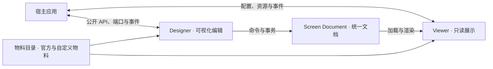

# Base Screen

Base Screen 是一个轻量、可嵌入、跨框架的大屏设计器基座，为现有 Web 应用提供可视化编辑、只读渲染和
物料扩展能力。宿主可以只接入展示页，也可以嵌入完整的设计器工作台，同时保留自己的业务界面和技术栈。

项目以 **Screen Document** 作为统一文档，以 **Web Components** 作为浏览器集成边界，以 **物料目录**
描述可使用的可视组件。Designer 编辑和 Viewer 展示围绕同一份文档工作；项目、数据、资产、发布和长任务的
真实处理由宿主负责，Base Screen 提供当前实例内的编辑、渲染与有界宿主端口。

[快速体验](#快速体验) · [集成指南](./docs/usage.md) · [当前能力基线](./docs/baseline/README.md) ·
[文档索引](./docs/README.md)

## 适用场景

- 在已有业务系统中嵌入大屏编辑页，复用宿主的账号、权限、路由、项目存储和发布流程。
- 根据同一份大屏文档提供编辑预览和只读展示，并通过宿主端口接入业务数据与变量。
- 建立自己的可视化物料库，将原生 Web Components、React 或 Vue 组件接入统一的设计与渲染流程。

Base Screen 的交付重点是可组合的前端基座。示例中的项目目录、资源列表和模拟数据用于说明接入方式，
生产环境中的业务规则与服务仍由宿主实现。

## 核心能力

- **统一文档与编辑历史**：严格的文档解析、诊断、序列化和 JSON Schema；编辑通过命令与事务提交，
  支持撤销、重做和当前项目会话的脏状态管理。
- **画布设计与属性编辑**：单选与多选、移动、缩放、旋转、编组、图层排序、吸附和参考线，
  配合属性检查器、批量样式编辑、调色板及静态文本的画布内直接编辑。
- **独立 Viewer**：消费文档与物料目录进行展示，不包含设计器编辑逻辑；宿主可单独使用
  `base-screen-viewer` 构建预览页或发布页。
- **官方物料与分类浏览**：提供文本、矩形、椭圆、图片、容器、图表、ECharts 和表格物料；
  物料库支持搜索、收藏、最近使用、宿主多级分组、条目封面和窄面板分类浮层。
- **数据与视觉联动**：支持静态数据、宿主资源与变量；声明数据绑定能力的物料可使用数据集参数、字段映射
  和预览。条件样式与 Blueprint 运行时用于表达组件状态变化和事件联动，实际数据处理由宿主完成。
- **Canvas / Blueprint 工作台**：画布与事件蓝图共用文档、事务和历史；Base Screen 提供工作台外壳、
  语义面板和图投影，中央图形渲染、布局算法及画布手势由宿主接入。
- **物料与宿主扩展**：通过 Manifest 声明属性、样式、事件和编辑控件，支持 React/Vue 物料桥接、
  插件能力授权、主题 Token、公开命名 slot，以及宿主资源插入、拖放和替换。

完整能力、约束与实现依据见[当前能力基线](./docs/baseline/README.md)。

## 核心模型

**文档**保存画布、组件、变量和事件蓝图等可序列化状态；**物料**是可放入画布的可视组件，Manifest 描述
它的能力，catalog 汇集当前实例可用的物料。**宿主**是嵌入 Base Screen 的应用，通过公开属性、方法、
端口和事件连接业务服务。



宿主不需要更换 React、Vue 或其他应用框架。跨框架物料通过桥接包接入，Viewer 与 Designer 的公共集成面
仍是 Custom Element；宿主扩展使用公开 API，不依赖设计器内部 Shadow DOM 或 Store。

## 与宿主的职责划分

| 领域 | Base Screen 负责 | 宿主负责 |
| --- | --- | --- |
| 文档与项目 | 严格契约、编辑事务、历史和当前项目会话 | 项目目录、存储、业务元数据及服务端并发控制 |
| 数据与变量 | 资源意图、结果校验与投影、请求取消、超时和迟到结果保护 | 查询、聚合、缓存、ETL、凭证与数据权限 |
| 物料与资产 | 物料 ABI、目录消费、卡片展示与资源插入协议 | 物料模块加载与信任、资产上传、存储和转码 |
| 预览与发布 | 本地预览、保存与发布请求、宿主预览接管入口 | 路由、鉴权、部署、公开 URL、截图、视频及批量导出 |
| 作者扩展 | 内建编辑控件、Blueprint 语义编辑、公开方法与 slot 协议 | 中央图形画布、代码编辑器和复杂领域配置编辑器 |

文档只保存可移植的数据，不承载访问凭证、数据库连接或宿主服务对象。需要后台队列、持久缓存、跨实例共享
或长期运行的任务，应通过宿主能力完成。边界依据见
[ADR-0027：轻量设计器基座与宿主处理](./docs/decisions/ADR-0027-lightweight-designer-foundation-host-processing.md)。

## 集成模式

| 模式 | 公共元素 | 文档与保存方式 |
| --- | --- | --- |
| 只读展示 | `base-screen-viewer` | 宿主加载并校验文档后赋给 `document` |
| 宿主控制的编辑 | `base-screen-designer` | 宿主设置 `document`，监听 `base-screen-change` 保存草稿 |
| 项目会话编辑 | `base-screen-designer` | 配置 `projectAdapter`，通过 `load(projectId)`、`save()` 对接项目服务 |

接入通常分为四步：

1. 确认依赖来源，安装所需包，并在浏览器入口显式注册 Viewer / Designer 和物料。
2. 创建物料目录，确保它包含文档使用的全部物料类型。
3. 先注册诊断与变更监听，再通过 `configure()` 配置目录、所需宿主端口及项目模式的适配器。
4. 直接文档模式使用 `@base-screen/contracts` 校验后赋值 `document`；项目模式由适配器校验输入，
   通过 `load(projectId)` 加载项目。

直接文档模式与项目模式应分别使用；绑定项目适配器后，通过项目 API 加载，不再直接赋值 `document`。
详细安装、初始化、资源接入和自定义物料示例见[集成指南](./docs/usage.md)；最小 Viewer 宿主见
[Host Quickstart](./examples/host-quickstart/README.md)。

**当前包为私有、仅 ESM 的包。** 同一 pnpm workspace 可直接接入；独立仓库必须使用发布方提供的完整
同批次包集。单个 SDK tarball 不是可独立安装的交付物，不能把本仓库的开发安装命令当作外部项目安装流程。

## 快速体验

本仓库开发环境要求 Node.js `22.23.2`、pnpm `11.18.0`。

```bash
pnpm install --frozen-lockfile
pnpm build
pnpm dev:browser-harness
```

打开终端输出的本地地址即可查看浏览器组合示例。在地址后追加 `?designer` 可切换为设计器布局，
追加 `?designer&material-group-stress` 可体验多级分类、长名称和窄面板浮层。

示例自带演示文档与模拟宿主能力。接入真实业务时，替换宿主适配器和端口实现，并使用包的公开导出。

## 示例

| 示例 | 主要用途 | 运行或验证入口 |
| --- | --- | --- |
| [host-quickstart](./examples/host-quickstart/README.md) | 仅使用公开 API 的最小 Vanilla / Vite Viewer 宿主 | 按示例说明接入；由 `pnpm verify:tarball` 验证 |
| [browser-harness](./examples/browser-harness) | Viewer、Designer、官方物料、项目适配器和插件管理器组合 | `pnpm dev:browser-harness` |
| [playground](./examples/playground/README.md) | Vue 宿主中的设计器、数据绑定、失败状态与业务资源面板 | `pnpm dev:playground` |
| [vue-harness](./examples/vue-harness) | Vue 物料桥接与 ECharts 渲染 | `pnpm dev:vue-harness` |
| [runtime-harness](./examples/runtime-harness) | 远程插件沙箱、宿主资源和 Blueprint 运行时 | `pnpm verify:runtime` |
| [color-picker-lab](./examples/color-picker-lab) | 颜色与渐变控件的独立交互实验 | `pnpm dev:color-picker-lab` |

## 包结构

仓库使用 pnpm / Turbo 管理 `packages/` 下的 12 个包，公共入口统一使用 `@base-screen/*`：

| 包 | 职责 |
| --- | --- |
| `contracts` | Screen Document、宿主契约、严格解析、诊断、序列化与 JSON Schema |
| `core` | 文档命令、事务、历史与 Blueprint 运行时 |
| `renderer` | 物料模型与 DOM 渲染，保持纯展示职责 |
| `engine` | Designer 会话、画布交互、检查器和工作台编排 |
| `material` | 官方物料实现、Manifest 和注册辅助 |
| `plugin-core` | 物料与插件契约、Manifest 校验和 catalog |
| `plugin-manager` | 插件预检、加载管理、生命周期和能力授权 |
| `plugin-sdk` | 面向插件与物料作者的定义、注册和物料包辅助 |
| `react` / `vue` | 将对应框架的组件桥接为物料 |
| `sdk` | Viewer、Designer、物料与插件的产品级组合入口 |
| `testing` | 基于公共 API 的 fixture 与一致性测试辅助，仅用于测试 |

跨包调用只使用声明的公共导出。物料契约由 `plugin-core` 拥有，`renderer` 不依赖具体官方物料，
`sdk` 负责组合而不实现各包的领域逻辑。仓库分层与依赖规则见 [AGENTS.md](./AGENTS.md)。

## 开发检查

日常检查：

```bash
pnpm format:check
pnpm lint
pnpm check:docs
pnpm typecheck
pnpm test
pnpm build
```

影响包、构建产物或公共契约的改动，交付前运行完整门禁：

```bash
pnpm verify:m0
```

`verify:m0` 会先执行格式化并写入文件，再运行静态检查、类型检查、测试、构建、包与 API 边界检查，
最后将 tarball 安装到临时消费者工程中验证。`pnpm verify:fast` 可用于不含 tarball 验证的日常迭代。
浏览器交互检查另见 `pnpm verify:browser`、`pnpm verify:playground` 和 `pnpm verify:vue-harness`。

公共声明或 package 子路径有意变化时，运行 `pnpm api:report` 更新并审查
`packages/*/etc/*.api.md`，同时为受影响包补充 Changeset。`pnpm check:api` 只校验基线，
不会自动接受 API 漂移。

`pnpm lint` 还会运行 `pnpm check:file-size`：新文件必须遵守仓库的分层行数上限，已有超限文件
按 `scripts/file-size-baseline.json` 中的逐文件精确上限冻结。拆分或缩减已有文件后运行
`pnpm file-size:baseline` 下调基线；该命令不会接受新增超限文件或已有文件继续增长。

## 文档导航

| 想了解的内容 | 入口 |
| --- | --- |
| 在自己的应用中嵌入 Base Screen | [集成指南](./docs/usage.md) |
| 已交付能力与已知边界 | [当前能力基线](./docs/baseline/README.md) |
| 创建数据集驱动的自定义物料 | [自定义组件最佳实践](./docs/custom-dataset-material-best-practice.md) |
| 为宿主配置大屏设计与物料创建 Skill | [宿主 Skill 快速接入](./docs/host-skill-manuals/01-quick-start.md) |
| 架构取舍与职责划分 | [架构决策记录](./docs/decisions/README.md) |
| 后续方向与候选主题 | [路线图](./docs/roadmap/README.md) |
| 验证失败排查 | [开发门禁故障排查](./docs/troubleshooting/verify-m0-troubleshooting.md) |

规格、计划、归档与来源记录统一从[文档索引](./docs/README.md)进入。当前能力以 Baseline 和已接受的 ADR
为依据，路线图中的候选主题不代表已经实现。

## 许可证

本项目采用 [MIT License](./LICENSE)。第三方来源、授权与使用边界见[来源记录](./docs/provenance/README.md)。
